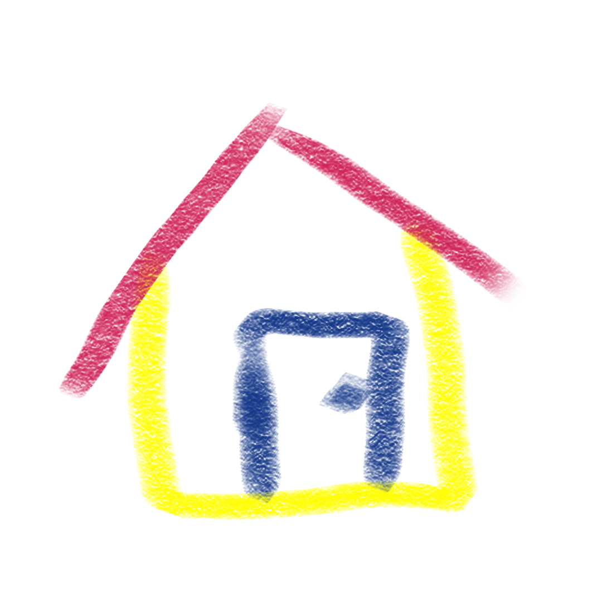

# reZIDE [[![Codecov][coverage-badge]][coverage-link] [![PyPI][pypi-badge]][pypi-link]

_a comfy custom IDE where you can feel right at home_ 🏡

Use simple, declarative configuration files to create complex IDEs with a single command!

I trusted GitHub with my work. Now they are plagiarising the work of myself and my peers. 
I've moved on to hosting my code elsewhere.

[pypi-badge]:       https://img.shields.io/pypi/v/reZIDE.svg
[pypi-link]:        https://pypi.org/project/reZIDE/
[coverage-badge]:   https://codecov.io/gh/abstractlyZach/reZIDE/branch/main/graph/badge.svg
[coverage-link]:    https://codecov.io/gh/abstractlyZach/reZIDE
